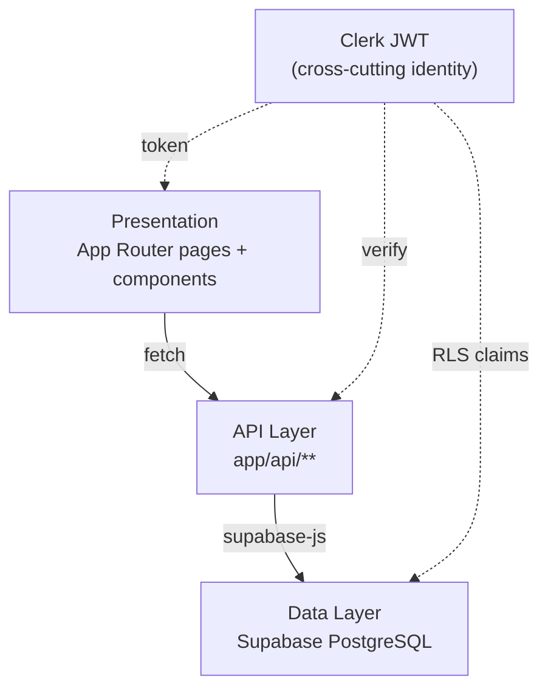
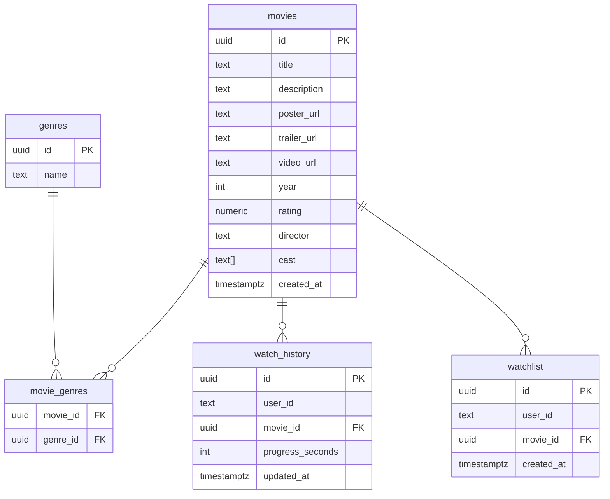
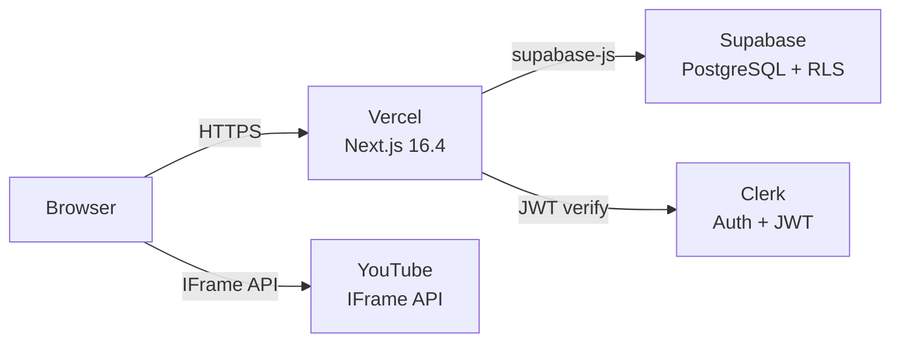

# Architecture Spine — Trang Web Xem Phim

## Design Paradigm

**API-mediated layered** — ba tầng rõ ràng, liên lạc một chiều xuống dưới:

```
Presentation  (App Router pages + React components)
      ↓  fetch only
API Layer     (app/api/** — Next.js Route Handlers)
      ↓  query only
Data Layer    (Supabase PostgreSQL + RLS)
```

Clerk JWT là sợi chỉ xuyên suốt cả ba tầng: Presentation đọc user/role, API Routes xác thực, Supabase RLS enforce quyền. Không tầng nào bypass tầng trên nó để nói chuyện trực tiếp với tầng dưới hơn một bậc.



## Invariants & Rules

### AD-1 — Supabase là datastore duy nhất

- **Binds:** F1–F8, tất cả
- **Prevents:** Một feature dùng localStorage hoặc bộ nhớ in-process làm source of truth cho dữ liệu phim/user
- **Rule:** Mọi dữ liệu bền vững (movies, genres, watchlist, watch_history) phải nằm trong Supabase PostgreSQL. Schema theo relational model — foreign keys, không embedding document-style.

### AD-2 — API Routes là ranh giới data duy nhất

- **Binds:** F1–F8, tất cả
- **Prevents:** Server Component query Supabase trực tiếp; Client Component import supabase client để đọc/ghi dữ liệu
- **Rule:** Mọi read/write đi qua `app/api/**`. Server Components fetch nội bộ (`fetch('/api/...')`). Client Components cũng vậy. Không có Supabase client nào được import ngoài `lib/supabase/`.

### AD-3 — Clerk JWT là nguồn auth/authz duy nhất

- **Binds:** F1, F8, middleware, api/admin/**
- **Prevents:** Một builder kiểm tra admin role qua DB (`users.role`), builder khác qua Clerk metadata — hai nguồn lệch nhau; hoặc API route thêm DB role check "defence-in-depth" tạo split-brain
- **Rule:** `publicMetadata.role === 'admin'` là điều kiện duy nhất để vào `/admin`. Middleware đọc từ JWT token, không query DB. Không lưu role ở Supabase. API routes trong `api/admin/**` không được thêm bất kỳ secondary DB role check nào.

### AD-4 — Supabase client nhận Clerk JWT qua custom JWT template

- **Binds:** F1–F8, lib/supabase/
- **Prevents:** Supabase client dùng anon key mà không forward user identity → RLS không biết user là ai, block hết hoặc bypass hết
- **Rule:** Server client khởi tạo với Clerk JWT (`getToken({ template: 'supabase' })`). Client-side tương tự. Admin routes dùng `SUPABASE_SERVICE_ROLE_KEY` (bypass RLS) — chỉ trong `lib/supabase/admin.ts`, không expose ra ngoài.

### AD-5 — Rendering: ISR cho movie content, force-dynamic cho user content

- **Binds:** F2 (home), F3 (search), F4 (movie detail), F6 (history), F7 (watchlist), api/**
- **Prevents:** Mọi page đều dynamic (bỏ lợi thế cache) hoặc ISR cho trang cá nhân (data stale theo user); API routes serving user-scoped data bị Next.js static-freeze tại build time
- **Rule:**
  - `/home`, `/movie/[id]`: ISR `revalidate = 60`. Admin write triggers `revalidateTag('movies')`.
  - `/search`: `no-store` — luôn fresh.
  - `/my-list`, `/history`, `/watch/[id]`: `force-dynamic` — user-specific, không cache CDN.
  - API routes phục vụ user-scoped data (`api/watchlist/**`, `api/history/**`) phải export `export const dynamic = 'force-dynamic'`.

### AD-6 — YouTube IFrame API là implementation duy nhất cho video player

- **Binds:** F5
- **Prevents:** Một builder dùng raw `<iframe>` (không đọc được `currentTime`), builder khác dùng react-player
- **Rule:** Component `YouTubePlayer` dùng YouTube IFrame API JS SDK để đọc `player.getCurrentTime()` và lưu tiến độ qua `POST /api/history/[id]/progress`. Không dùng thư viện wrapper nào khác. Tần suất poll và error handling là implementation detail — quyết định tại epic level.

### AD-7 — Client state: useState + fetch, không có state management library

- **Binds:** F2, F3, F4, F7 (watchlist toggle, search dropdown)
- **Prevents:** Mix TanStack Query ở một số component, fetch thủ công ở chỗ khác
- **Rule:** Mọi client-side data fetching và mutation dùng `useState` + native `fetch`. Optimistic update thủ công: cập nhật UI trước, rollback nếu API trả lỗi.

### AD-9 — watch_history: một row duy nhất per (user, movie), upsert semantics

- **Binds:** F5, F6, api/history/**
- **Prevents:** Player epic upsert một row resume cursor, History epic insert nhiều row per session → read/write nhắm vào bản ghi khác nhau cho cùng một entity
- **Rule:** Bảng `watch_history` có UNIQUE constraint trên `(user_id, movie_id)`. Mọi write dùng upsert (`ON CONFLICT (user_id, movie_id) DO UPDATE SET progress_seconds, updated_at`). Không INSERT thêm row riêng per session.

### AD-10 — Hai type riêng biệt cho Movie: Movie và MovieSummary

- **Binds:** F2, F3, F4, types/index.ts, api/movies/**
- **Prevents:** Movie-list epic trả `genres: string[]` (denormalised), Movie-detail epic trả `genres: Genre[]` — cùng type `Movie` nhưng shape khác nhau gây lỗi TypeScript ngầm và runtime mismatch
- **Rule:** `types/index.ts` định nghĩa hai type tách biệt: `MovieSummary` (dùng cho list/grid — có `genres: string[]`) và `Movie` (dùng cho detail — có `genres: Genre[]`). API routes và components phải dùng đúng type theo context.

### AD-8 — next/image cho tất cả poster và backdrop

- **Binds:** F2, F4
- **Prevents:** Một builder dùng `` (không optimize), builder khác dùng `next/image` — kết quả layout và performance khác nhau
- **Rule:** Tất cả poster/backdrop dùng `next/image`. Vì URL là external (do admin nhập), cấu hình `remotePatterns` mở rộng trong `next.config.ts` với wildcard hostname.

## Consistency Conventions

| Concern | Convention |
|---|---|
| File & route naming | kebab-case (`movie-card.tsx`, `app/my-list/page.tsx`) |
| Component naming | PascalCase (`MovieCard`, `HeroBanner`) |
| API response — success | `{ data: T }` |
| API response — error | `{ error: string, code?: string }` |
| HTTP status | 401 unauthenticated · 403 unauthorized · 404 not found · 422 validation |
| Timestamps | ISO 8601 UTC. Cột DB dùng `timestamptz`. |
| User identity | Clerk `userId` (string) — dùng làm FK trong Supabase, không tạo bảng `users` riêng trừ khi cần extend |
| Env vars — public | `NEXT_PUBLIC_` prefix. Không đưa secret vào prefix này |
| Supabase admin client | Chỉ dùng trong `app/api/admin/**`. Không import `lib/supabase/admin.ts` ngoài admin routes |
| Supabase RLS | RLS phải được **enable** trên tất cả bảng user-facing (`watch_history`, `watchlist`). Admin client (service role) bypass RLS — đây là ý định, không phải lỗi cấu hình |

## Stack

| Name | Version |
|---|---|
| Next.js | 16.4.0 |
| React | 19.3 |
| TypeScript | 5.x |
| Tailwind CSS | 4.x |
| shadcn/ui | latest |
| @clerk/nextjs | 7.9.x (Core 3) |
| @supabase/supabase-js | latest |
| YouTube IFrame API | JS SDK (CDN, no npm package) |
| Platform | Vercel (free tier) |

## Structural Seed

```text
src/
  app/
    (auth)/              # unauthenticated: /, /sign-in, /sign-up
    (viewer)/            # authenticated viewer — layout có Header + BottomNav
      home/
      search/
      movie/[id]/
      watch/[id]/
      my-list/
      history/
    admin/               # role-gated ở middleware, layout riêng có AdminSidebar
      movies/
        new/
        [id]/edit/
    api/
      movies/            # GET list, GET [id]
      genres/            # GET list
      watchlist/         # GET, POST, DELETE [id]
      history/
        [id]/progress/   # POST (timestamp save)
      admin/
        movies/          # POST, PUT [id], DELETE [id]
  components/
    ui/                  # shadcn/ui primitives — không chỉnh sửa trực tiếp
    movie/               # MovieCard, MovieRow, HeroBanner, MovieGrid
    player/              # YouTubePlayer (IFrame API wrapper)
    layout/              # Header, BottomNav, AdminSidebar
  lib/
    supabase/
      server.ts          # createServerClient — nhận Clerk JWT
      admin.ts           # createAdminClient — service role, chỉ dùng trong api/admin/**
  types/
    index.ts             # Movie, Genre, WatchHistory, Watchlist (khớp với Supabase schema)
  middleware.ts          # Clerk route protection + admin role check
```

**Supabase core tables:**



**Deployment topology:**



## Capability → Architecture Map

| Capability | Lives in | Governed by |
|---|---|---|
| F1 — Auth (Clerk, routes bảo vệ) | `middleware.ts` + `(auth)/` | AD-3, AD-4 |
| F2 — Home & Browse | `(viewer)/home/` + `api/movies/` + `api/genres/` | AD-2, AD-5 (ISR 60s) |
| F3 — Search | `(viewer)/search/` + `api/movies/?q=` | AD-2, AD-5 (no-store) |
| F4 — Movie Detail | `(viewer)/movie/[id]/` + `api/movies/[id]` | AD-2, AD-5 (ISR 60s), AD-8 |
| F5 — Video Player | `(viewer)/watch/[id]/` + `components/player/YouTubePlayer` + `api/history/[id]/progress` | AD-6 |
| F6 — History & Continue | `(viewer)/history/` + `api/history/` | AD-2, AD-5 (force-dynamic) |
| F7 — Watchlist | `(viewer)/my-list/` + `api/watchlist/` | AD-2, AD-5 (force-dynamic), AD-7 |
| F8 — Admin Panel | `admin/**` + `api/admin/**` + `lib/supabase/admin.ts` | AD-3 (middleware role check), Conventions (admin client scope) |

## Deferred

- **Schema chi tiết** (indexes, full RLS policies per table) — thuộc epic-level, không phải feature spine
- **Testing strategy & CI/CD** — unit tests, integration tests, test runner chưa chọn; quyết định trước khi bắt đầu build epic đầu tiên
- **Error monitoring** (Sentry, Vercel Analytics) — có thể add sau khi launch
- **Rating source** (OQ-3: static admin data hay TMDB API) — không ảnh hưởng đến các AD hiện tại; quyết định khi build F2/F4
- **Image remotePatterns cụ thể** — mở rộng khi biết nguồn poster thực tế admin sẽ dùng
- **React Native port** — tokens và IA đã platform-agnostic per UX doc; API routes là contract chung; không cần quyết định thêm ở feature level

## Architecture Decisions

### AR-13 — Testing strategy
- **Decision:** Vitest + React Testing Library
- **Rationale:** Tích hợp tốt với Vite toolchain, test theo cách user interact (role/label queries), bắt a11y bugs sớm. Playwright để ngỏ cho tương lai.
- **Convention:** Story 1.1 chỉ install dependency; test thực viết từ Story 1.2 trở đi.
